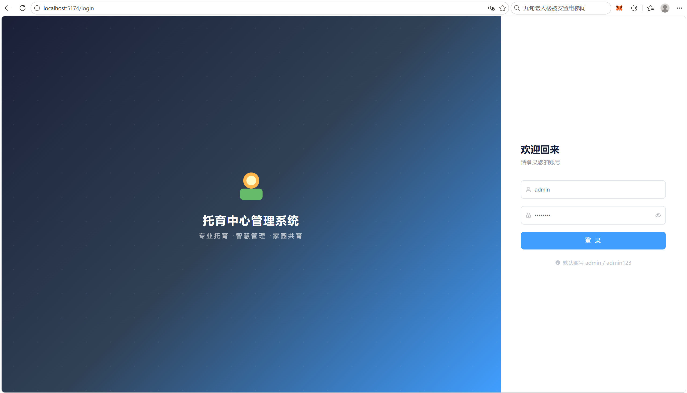
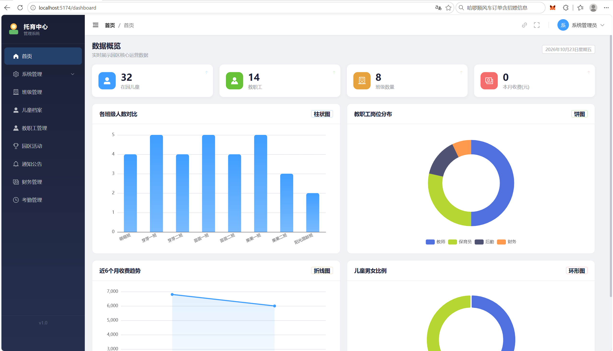
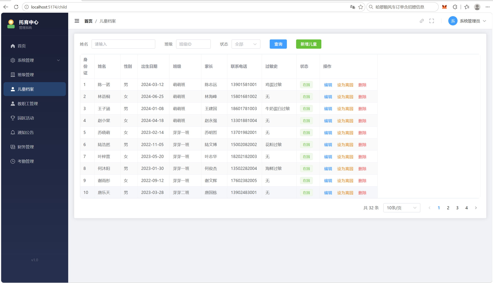
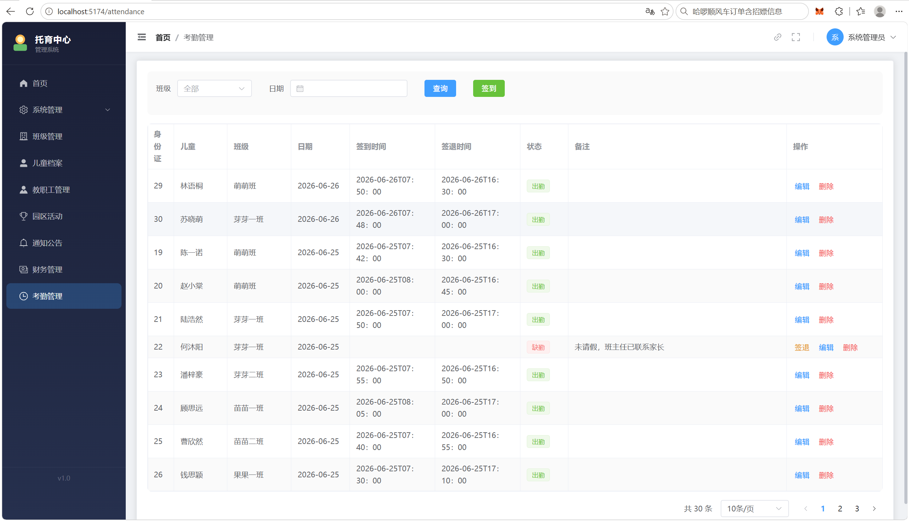
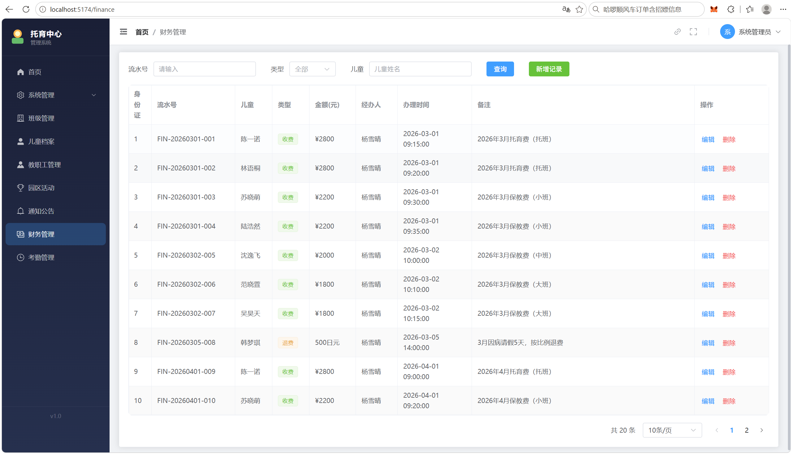
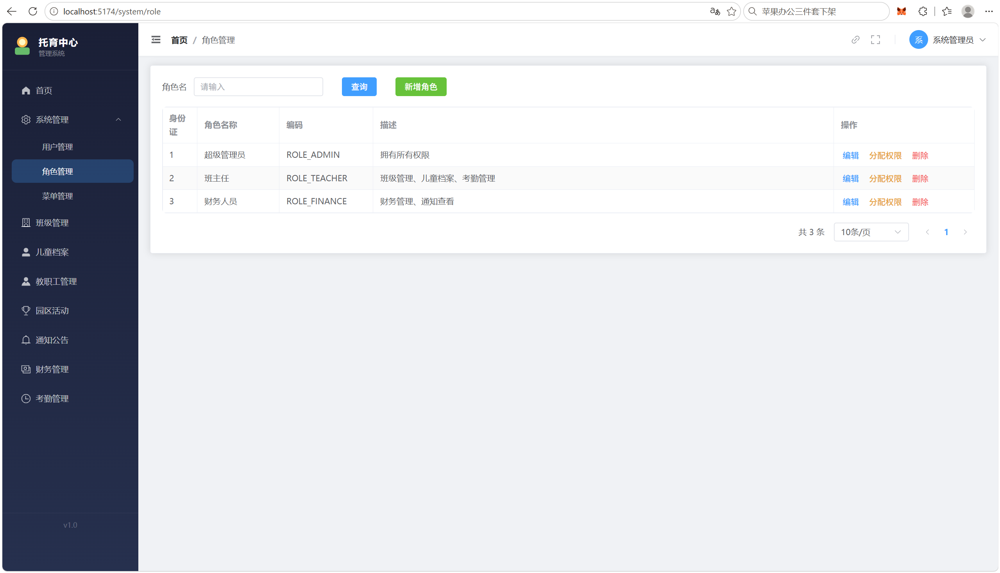

<div align="center">

# 🏫 托育中心管理系统

**Daycare Center Management System**

一套前后端分离的托育中心（托育园）综合管理平台，覆盖 **儿童、教师、班级、考勤、财务、活动、通知** 等日常业务，并内置 **基于 RBAC 的权限管理与操作日志审计**，适合作为托育机构的信息化管理系统。

[技术栈](#-技术栈) · [功能特性](#-功能特性) · [界面截图](#-界面截图) · [核心亮点](#-核心亮点) · [快速开始](#-快速开始)

</div>

---

## 📖 项目简介

本系统旨在帮助托育中心实现日常运营的数字化管理，解决传统人工记录方式存在的**数据分散、统计困难、权限不清**等问题。系统分为前端管理界面与后端 REST 服务两部分：

- **前端**：基于 Vue 3 的单页应用（SPA），采用 Element Plus 组件库，提供友好的交互界面与数据可视化看板。
- **后端**：基于 Spring Boot 3 的 RESTful API 服务，统一封装响应结构、异常处理与登录鉴权，通过 MyBatis-Plus 访问 MySQL 数据库。

系统支持多角色登录，管理员可对用户、角色、菜单权限进行灵活配置，实现**不同岗位（园长、教师、财务等）看到不同功能**的细粒度权限控制。

---

## 🛠 技术栈

### 后端

| 技术 | 版本 | 用途 |
|------|------|------|
| Java | 17 | 开发语言 |
| Spring Boot | 3.3.1 | 基础框架 |
| MyBatis-Plus | 3.5.7 | ORM / 持久层 |
| MySQL | 8.x | 关系型数据库 |
| Knife4j | 4.5.0 | 在线 API 文档（OpenAPI 3） |
| jBCrypt | 0.4 | 密码加密 |
| Lombok | - | 简化样板代码 |

### 前端

| 技术 | 版本 | 用途 |
|------|------|------|
| Vue | 3.5.x | 前端框架 |
| Vite | 5.4.x | 构建工具 |
| Element Plus | 2.14.x | UI 组件库 |
| Pinia | 3.0.x | 状态管理 |
| Vue Router | 4.6.x | 路由管理 |
| ECharts | 6.1.x | 数据可视化 |
| Axios | 1.18.x | HTTP 请求 |

---

## ✨ 功能特性

### 🔐 系统管理
- **登录鉴权**：基于 Session 的登录拦截，未登录请求返回 401；密码采用 BCrypt 加密存储，不存明文。
- **用户管理**：系统用户的增删改查、启用/禁用。
- **角色管理**：角色的创建与权限分配。
- **菜单管理**：菜单（权限点）的动态配置。
- **RBAC 权限控制**：通过「用户—角色—菜单」三级模型实现细粒度权限，前端根据权限动态渲染菜单。

### 👶 核心业务
- **儿童管理**：在园儿童档案的录入、编辑、查询与分页展示。
- **教师管理**：教职工信息维护。
- **班级管理**：班级信息与分班管理。
- **考勤管理**：儿童每日出勤情况的记录与统计。
- **财务管理**：收费/退费等资金流水记录（金额使用 `DECIMAL` 存储，避免浮点精度丢失）。
- **活动管理**：园区活动的发布与展示。
- **通知公告**：公告的发布与查看。

### 📊 数据看板
- 基于 ECharts 的可视化统计看板，直观展示在园人数、考勤情况、财务概况等关键指标。

### 📝 操作日志
- 基于 AOP（面向切面编程）的自动化操作日志记录，自动采集操作人、操作类型、操作内容等信息，便于审计追溯。

---

## 📸 界面截图

> 以下为界面截图预留位置，请运行项目后将截图放入 `docs/images/` 目录并替换对应文件名。

| 登录页 | 数据看板 | 儿童管理 |
|:---:|:---:|:---:|
|  |  |  |

| 考勤管理 | 财务管理 | 权限管理 |
|:---:|:---:|:---:|
|  |  |  |

---

## 💡 核心亮点

1. **前后端分离架构**：Vue 3 SPA 与 Spring Boot REST API 解耦，通过 CORS 处理跨域，职责清晰、易于维护与扩展。

2. **统一响应与异常处理**：后端统一封装返回结构（`code / message / data`），并通过全局异常处理器统一捕获业务异常，前端只需处理标准结构。

3. **RBAC 权限模型**：`sys_user`、`sys_role`、`sys_menu`、`sys_role_menu` 四张表协作，实现「用户—角色—菜单」的权限链路；前端根据后端返回的菜单权限动态生成侧边栏，未授权页面不可见、未授权接口不可访问。

4. **AOP 操作日志**：通过自定义注解 + `OperationLogAspect` 切面，在业务方法上以声明式方式自动记录操作日志，业务代码零侵入，日志统一落库到 `sys_operation_log`。

5. **密码安全**：用户密码使用 BCrypt 加盐哈希后存储，登录时通过 BCrypt 校验，杜绝明文存储风险。

6. **在线 API 文档**：集成 Knife4j，运行后即可在浏览器访问可视化接口文档，便于前后端联调与接口自测。

---

## 🗂 项目结构

```
daycare_center/
├── daycare-center-backend/          # 后端（Spring Boot）
│   └── src/main/java/com/soft231/daycarecenterbackend/
│       ├── aspect/                  # AOP 切面（操作日志）
│       ├── common/                  # 统一响应、通用工具
│       ├── config/                  # 配置类（CORS、MyBatis-Plus、Knife4j 等）
│       ├── controller/              # REST 控制器
│       ├── dto/                     # 数据传输对象
│       ├── entity/                  # 数据库实体
│       ├── exception/               # 全局异常处理
│       ├── interceptor/             # 登录拦截器
│       ├── mapper/                  # MyBatis-Plus Mapper
│       └── service/                 # 业务层接口与实现
│       └── src/main/resources/
│           ├── db/                  # 数据库脚本（init.sql / data.sql）
│           └── mapper/              # MyBatis XML 映射
└── daycare-center-frontend/         # 前端（Vue 3）
    └── src/
        ├── components/layout/       # 布局组件（头部、侧边栏、主布局）
        ├── views/                   # 页面视图
        │   ├── dashboard/           # 数据看板
        │   ├── child/               # 儿童管理
        │   ├── teacher/             # 教师管理
        │   ├── class/               # 班级管理
        │   ├── attendance/          # 考勤管理
        │   ├── finance/             # 财务管理
        │   ├── activity/            # 活动管理
        │   ├── notice/              # 通知公告
        │   └── system/              # 系统管理（用户/角色/菜单）
        ├── router/                  # 路由配置
        └── store/                   # Pinia 状态管理
```

---

## 🗄 数据库设计

系统共 **12 张表**，核心表及其关系如下：

| 表名 | 说明 |
|------|------|
| `sys_user` | 系统用户 |
| `sys_role` | 角色 |
| `sys_menu` | 菜单 / 权限点 |
| `sys_role_menu` | 角色—菜单关联表（RBAC） |
| `sys_operation_log` | 操作日志 |
| `class_info` | 班级 |
| `child` | 儿童 |
| `teacher` | 教师 |
| `activity` | 活动 |
| `notice` | 通知公告 |
| `finance` | 财务流水 |
| `attendance` | 考勤记录 |

建表脚本与初始化数据见 `daycare-center-backend/src/main/resources/db/` 目录下的 `init.sql` 与 `data.sql`。

---

## 🚀 快速开始

### 环境要求

- JDK 17+
- Maven 3.6+
- Node.js 18+
- MySQL 8.x

### 1. 初始化数据库

执行后端 `src/main/resources/db/` 目录下的 `init.sql` 与 `data.sql`，创建数据库并导入初始化数据。

### 2. 启动后端

```bash
cd daycare-center-backend
# 根据本地环境修改 application.yml 中的数据库连接信息
./mvnw spring-boot:run
```

后端启动后，接口文档可访问：`http://localhost:8080/doc.html`

### 3. 启动前端

```bash
cd daycare-center-frontend
npm install
npm run dev
```

前端开发服务器启动后，浏览器访问终端提示的地址（默认 `http://localhost:5173`）。

---

## 📄 相关文档

项目根目录下附有以下文档，可作为设计与测试的补充说明：

- `项目规划书.md` — 项目背景、需求分析与整体规划
- `软件测试报告.md` — 系统测试情况与结果
- `系统功能测试手册.md` — 各功能模块的测试用例
- `AOP操作日志与权限分配详解.md` — AOP 日志与 RBAC 权限的实现详解

---

## 📝 说明

本项目为课程 / 个人实践项目，用于展示前后端分离 Web 系统的完整开发流程。如有问题或建议，欢迎通过 GitHub Issues 交流。

---

<div align="center">

**托育中心管理系统** · 前后端分离 · RBAC 权限 · 操作日志审计

</div>